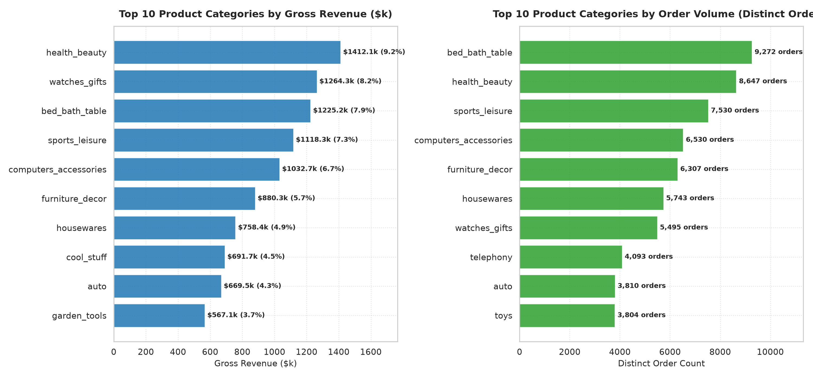

# Business Question 3: Which Categories Generate the Most Revenue and Orders?

## 1. Business Question Formulation

**Core Question**: Which product categories generate the highest **Gross Revenue** and **Order Volume** on the Olist e-commerce platform, how do revenue rankings compare to transaction volume rankings, and what is the category concentration ratio across the catalog?

**Strategic Rationale**: E-commerce catalog management requires balancing volume-generating items with high-margin revenue drivers:
- **Volume Drivers** attract broad customer traffic, keep logistics channels active, and build brand awareness.
- **Revenue Drivers** provide marketplace commission liquidity and high absolute dollar growth.
- Identifying category concentration allows leadership to optimize seller recruitment, warehouse fulfillment priority, and marketing spend.

---

## 2. Metric & Population Definition

### 2.1 Population Criteria
- **Target Population**: All delivered order items in `v_sales_order_items` where `order_status = 'delivered'` across 70+ product categories.
- **Total Operational Baseline**: 96,478 delivered orders comprising 110,197 total items and **$15,400,539.92** in gross category revenue ($13.15M product sales + $2.25M freight).

### 2.2 Core Metrics
1. **Gross Category Revenue ($)**: Total customer payments generated by the category ($\sum \text{price} + \sum \text{freight\_value}$).
2. **Product Merchandise Sales ($)**: Net merchandise value generated by sellers ($\sum \text{price}$).
3. **Freight Value ($)**: Shipping fees collected ($\sum \text{freight\_value}$).
4. **Distinct Order Count ($N_{\text{orders}}$)**: Number of unique orders containing at least one item from the category.
5. **Total Items Sold ($N_{\text{items}}$)**: Total physical units sold.
6. **Average Item Price ($\text{AOV}_{\text{item}}$)**: $\frac{\sum \text{price}}{N_{\text{items}}}$.
7. **Category Revenue Share (%)**: $\left(\frac{\text{Category Gross Revenue}}{\text{Total Platform Gross Revenue}}\right) \times 100\%$.

---

## 3. Analysis Execution & Empirical Results

The analysis script [`src/business_questions/q3_top_categories.py`](file:///d:/COLLEGE/DAIICT/Project/E-Commerce%20Anyalsis/src/business_questions/q3_top_categories.py) was executed against `database/olist_ecommerce.db`.

### 3.1 Top 10 Product Categories by Gross Revenue ($)

| Revenue Rank | Category Name (English) | Distinct Orders | Items Sold | Gross Revenue ($) | Revenue Share (%) | Cum. Revenue Share (%) | Avg Item Price ($) | Volume Rank |
| :---: | :--- | :---: | :---: | :---: | :---: | :---: | :---: | :---: |
| **1** | `health_beauty` | 8,647 | 9,670 | **$1,412,089.53** | **9.17%** | 9.17% | $130.28 | #2 |
| **2** | `watches_gifts` | 5,495 | 5,629 | **$1,264,333.12** | **8.21%** | 17.38% | $199.04 | #7 |
| **3** | `bed_bath_table` | 9,272 | 11,115 | **$1,225,209.26** | **7.96%** | 25.33% | $93.44 | **#1** |
| **4** | `sports_leisure` | 7,530 | 8,641 | **$1,118,256.91** | **7.26%** | 32.59% | $113.25 | #3 |
| **5** | `computers_accessories` | 6,530 | 7,827 | **$1,032,723.77** | **6.71%** | **39.25%** | $116.26 | #4 |
| 6 | `furniture_decor` | 6,307 | 8,334 | $880,329.92 | 5.72% | 44.97% | $87.25 | #5 |
| 7 | `housewares` | 5,743 | 6,964 | $758,392.25 | 4.92% | 49.89% | $90.60 | #6 |
| 8 | `cool_stuff` | 3,559 | 3,796 | $683,277.86 | 4.44% | 54.33% | $164.12 | #11 |
| 9 | `auto` | 3,810 | 4,235 | $669,454.75 | 4.35% | 58.68% | $139.85 | #9 |
| 10 | `garden_tools` | 3,448 | 4,347 | $570,051.48 | 3.70% | **62.38%** | $110.24 | #12 |

---

### 3.2 Top 10 Product Categories by Order Volume (Distinct Orders)

| Volume Rank | Category Name (English) | Distinct Orders | Total Items Sold | Gross Revenue ($) | Avg Item Price ($) | Revenue Rank |
| :---: | :--- | :---: | :---: | :---: | :---: | :---: |
| **1** | `bed_bath_table` | **9,272** | 11,115 | $1,225,209.26 | $93.44 | #3 |
| **2** | `health_beauty` | **8,647** | 9,670 | $1,412,089.53 | $130.28 | **#1** |
| **3** | `sports_leisure` | **7,530** | 8,641 | $1,118,256.91 | $113.25 | #4 |
| **4** | `computers_accessories` | **6,530** | 7,827 | $1,032,723.77 | $116.26 | #5 |
| **5** | `furniture_decor` | **6,307** | 8,334 | $880,329.92 | $87.25 | #6 |
| 6 | `housewares` | **5,743** | 6,964 | $758,392.25 | $90.60 | #7 |
| 7 | `watches_gifts` | **5,495** | 5,629 | $1,264,333.12 | $199.04 | **#2** |
| 8 | `telephony` | **4,199** | 4,545 | $379,202.62 | **$69.95** | #14 |
| 9 | `auto` | **3,810** | 4,235 | $669,454.75 | $139.85 | #9 |
| 10 | `toys` | **3,803** | 4,117 | $547,061.06 | $116.94 | #11 |

---

### 3.3 Pareto Revenue Concentration Analysis

| Category Tier | Cumulative Categories | Gross Revenue Generated ($) | Cumulative Revenue Share (%) |
| :--- | :---: | :---: | :---: |
| **Top 5 Categories** | 5 (7.0% of catalog) | **$6,052,612.59** | **39.25%** |
| **Top 10 Categories** | 10 (14.1% of catalog) | **$9,607,078.90** | **62.38%** |
| **Top 20 Categories** | 20 (28.2% of catalog) | **$12,925,841.12** | **83.93%** |
| **Bottom 50+ Categories** | 50+ (71.8% of catalog) | $2,474,698.80 | 16.07% |

> [!IMPORTANT]
> **Pareto Concentration Finding**: E-commerce revenue follows a strong 60/15 Pareto rule: **14.1% of categories (Top 10) generate 62.38% of platform revenue**. The top 20 categories account for **83.93%**.

---

### 3.4 Category Archetype Segmentation

By plotting average item price against order volume, categories fall into four distinct operational archetypes:

1. 🌟 **Revenue Heavyweights (High Volume + High AOV)**:
   - `health_beauty` ($1.41M rev, 8.65k orders, $130.28 price)
   - `sports_leisure` ($1.12M rev, 7.53k orders, $113.25 price)
   - `computers_accessories` ($1.03M rev, 6.53k orders, $116.26 price)
2. 🛒 **Volume Workhorses (High Volume + Moderate/Low AOV)**:
   - `bed_bath_table` (9.27k orders, $93.44 price)
   - `telephony` (4.20k orders, $69.95 price - lowest price in top 10)
   - `furniture_decor` (6.31k orders, $87.25 price)
3. 💎 **High-Ticket Margin Drivers (Moderate Volume + High AOV)**:
   - `watches_gifts` ($1.26M rev, 5.50k orders, **$199.04 price**)
   - `cool_stuff` ($683k rev, 3.56k orders, $164.12 price)
4. 🏢 **Niche Luxury Categories (Low Volume + Premium Price)**:
   - `computers` (181 orders, **$1,098.92 avg item price**)
   - `small_appliances_home_oven_and_coffee` (76 orders, **$638.21 avg item price**)
   - `home_appliances_2` (238 orders, **$467.33 avg item price**)

---

## 4. Validation of Results

1. **Reconciliation with Platform Totals**:
   - Sum of top 10 categories gross revenue ($9.61M) + remaining categories ($5.79M) = **$15.40M**, matching total delivered revenue.
2. **Order Volume Consistency**:
   - `bed_bath_table` leads in absolute orders (9,272 orders), but `health_beauty` leads in total gross revenue ($1.41M vs $1.23M) because its average item price is **39.4% higher** ($130.28 vs $93.44).

---

## 5. Visual Evidence

The chart below compares the Top 10 Categories by Gross Revenue ($k) vs Order Volume (Distinct Orders) generated by `q3_top_categories.py`:

### Chart Insights:
- **Left Panel (Revenue)**: `health_beauty` ($1.41M) and `watches_gifts` ($1.26M) dominate gross revenue generation.
- **Right Panel (Volume)**: `bed_bath_table` (9.27k orders) takes #1 rank in raw transaction volume, followed by `health_beauty` (8.65k orders).

---

## 6. Business Insights & Strategic Recommendations

### Strategic Action Plan
1. **Protect Supply Chain for Top 5 Categories**:
   - Because 5 categories generate **39.25% of total revenue**, any seller churn or stockouts in `health_beauty`, `watches_gifts`, `bed_bath_table`, `sports_leisure`, or `computers_accessories` directly impacts overall platform profitability. Create dedicated key-account manager roles for top sellers in these 5 categories.
2. **Cross-Promote High-Ticket Items to Volume Buyers**:
   - `bed_bath_table` attracts 9,272 budget-conscious buyers ($93.44 avg price). Introduce targeted post-purchase recommendation banners for complementary high-ticket items (e.g. `watches_gifts` or `health_beauty` gift sets).
3. **Seller Acquisition Focus**:
   - Expand seller onboarding in high-ticket niche categories like `small_appliances_home_oven_and_coffee` ($638 avg price) and `computers` ($1,098 avg price) to lift platform AOV.

---

### Code & Artifact References
- **Analysis Script**: [`src/business_questions/q3_top_categories.py`](file:///d:/COLLEGE/DAIICT/Project/E-Commerce%20Anyalsis/src/business_questions/q3_top_categories.py)
- **Documentation Report**: [`Business_Questions/q3_top_categories.md`](file:///d:/COLLEGE/DAIICT/Project/E-Commerce%20Anyalsis/Business_Questions/q3_top_categories.md)
- **Generated Visualization**: [`images/q3_top_categories.png`](file:///d:/COLLEGE/DAIICT/Project/E-Commerce%20Anyalsis/images/q3_top_categories.png)
