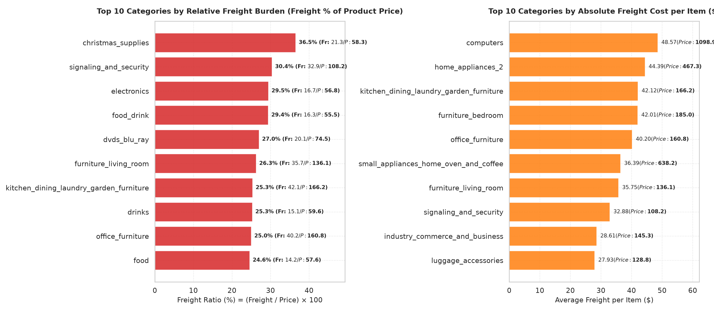

# Business Question 4: Which Categories Have the Highest Freight Burden?

## 1. Business Question Formulation

**Core Question**: Which product categories on the Olist e-commerce platform suffer from the highest **Freight Burden**—evaluated both in **relative terms** (shipping cost as a percentage of product item price) and **absolute terms** (dollar shipping cost per item)—and how does freight friction impact overall unit economics?

**Strategic Rationale**: In e-commerce, high freight costs create severe checkout friction, increasing cart abandonment and suppressing customer conversion rates:
- **Relative Freight Burden (Freight Ratio %)**: When shipping fees represent 25%–35%+ of the item price, buyers perceive low price-to-value and are far less likely to complete purchase.
- **Absolute Freight Burden ($)**: Bulky or heavy items consume excessive carrier handling fees, squeezing seller margins and requiring specialized fulfillment logistics.

---

## 2. Metric & Population Definition

### 2.1 Population Criteria
- **Target Population**: All delivered order items in `v_sales_order_items` where `order_status = 'delivered'`, filtered to categories with a minimum statistical baseline of **$\ge 50$ distinct orders** (59 product categories evaluated).

### 2.2 Core Metrics
1. **Freight Ratio (%)**: 
   $$\text{Freight Ratio}_{\text{Cat}} = \left( \frac{\sum \text{freight\_value}}{\sum \text{price}} \right) \times 100\%$$
2. **Average Freight per Item ($\text{Freight}_{\text{item}}$)**: Mean shipping cost collected per physical unit ($\text{Mean}(\text{freight\_value})$).
3. **Average Item Price ($\text{Price}_{\text{item}}$)**: Mean merchandise price per unit ($\text{Mean}(\text{price})$).
4. **Gross Revenue Share of Freight (%)**: 
   $$\text{Freight Share}_{\text{Gross}} = \left( \frac{\sum \text{freight\_value}}{\sum \text{item\_total\_value}} \right) \times 100\%$$

---

## 3. Analysis Execution & Empirical Results

The analysis script [`src/business_questions/q4_freight_burden_categories.py`](file:///d:/COLLEGE/DAIICT/Project/E-Commerce%20Anyalsis/src/business_questions/q4_freight_burden_categories.py) was executed against `database/olist_ecommerce.db`.

### 3.1 Top 10 Categories by Relative Freight Burden (Freight Ratio %)

| Rank | Category Name (English) | Orders | Avg Item Price ($) | Avg Freight ($) | Freight Ratio (%) | Freight Share of Gross (%) | Operational Cause |
| :---: | :--- | :---: | :---: | :---: | :---: | :---: | :--- |
| **1** | `christmas_supplies` | 125 | $58.25 | $21.27 | **36.52%** | **26.75%** | Low Item Price / Volumetric Packaging |
| **2** | `signaling_and_security` | 138 | $108.20 | $32.88 | **30.39%** | 23.31% | Heavy Metal Hardware / Bulky Equipment |
| **3** | `electronics` | 2,517 | $56.81 | $16.74 | **29.46%** | 22.76% | Low Item Price / Heavy Consumer Tech |
| **4** | `food_drink` | 221 | $55.55 | $16.34 | **29.41%** | 22.73% | Low Item Price / Heavy Liquid Weight |
| **5** | `dvds_blu_ray` | 56 | $74.47 | $20.12 | **27.02%** | 21.27% | Low Price / Standard Postal Minimums |
| **6** | `furniture_living_room` | 414 | $136.06 | $35.75 | **26.27%** | 20.81% | **Bulky Freight / Large Oversized Boxes** |
| **7** | `kitchen_garden_furniture` | 241 | $166.18 | $42.12 | **25.35%** | 20.22% | **Bulky Freight / Large Oversized Boxes** |
| **8** | `drinks` | 287 | $59.64 | $15.07 | **25.27%** | 20.17% | Heavy Liquid Volume / Protective Packing |
| **9** | `office_furniture` | 1,254 | $160.76 | $40.20 | **25.01%** | 20.00% | **Bulky Freight / Heavy Office Furniture** |
| **10** | `food` | 441 | $57.58 | $14.16 | **24.58%** | 19.73% | Low Item Price / Perishable Weight |

---

### 3.2 Top 10 Categories by Absolute Freight Cost per Item ($)

| Rank | Category Name (English) | Orders | Avg Item Price ($) | Avg Freight per Item ($) | Freight Ratio (%) | Primary Logistics Driver |
| :---: | :--- | :---: | :---: | :---: | :---: | :--- |
| **1** | `computers` | 177 | $1,098.92 | **$48.57** | 4.42% | High-value fragile insurance & secure handling |
| **2** | `home_appliances_2` | 227 | $467.33 | **$44.39** | 9.50% | Heavy large home appliances |
| **3** | `kitchen_garden_furniture` | 241 | $166.18 | **$42.12** | 25.35% | Oversized patio & outdoor furniture boxes |
| **4** | `furniture_bedroom` | 90 | $184.97 | **$42.01** | 22.71% | Heavy bedroom furniture & mattresses |
| **5** | `office_furniture` | 1,254 | $160.76 | **$40.20** | 25.01% | Heavy desks, office chairs, metal filing units |
| 6 | `small_appliances_oven_coffee`| 72 | $638.21 | $36.39 | 5.70% | High-value espresso machines & ovens |
| 7 | `furniture_living_room` | 414 | $136.06 | $35.75 | 26.27% | Sofas, coffee tables, TV entertainment centers |
| 8 | `signaling_and_security` | 138 | $108.20 | $32.88 | 30.39% | Heavy industrial hardware & security poles |
| 9 | `industry_commerce_business`| 232 | $145.28 | $28.61 | 19.69% | Commercial machinery & store fixtures |
| 10 | `luggage_accessories` | 1,019 | $128.79 | $27.93 | 21.68% | Volumetric suitcases & traveling trunks |

---

### 3.3 Top 5 Lowest Freight Burden Categories (High Freight Efficiency)

| Rank | Category Name (English) | Orders | Avg Item Price ($) | Avg Freight ($) | Freight Ratio (%) | Why Freight Ratio is Low |
| :---: | :--- | :---: | :---: | :---: | :---: | :--- |
| **1** | `computers` | 177 | $1,098.92 | $48.57 | **4.42%** | High item price dilutes freight cost |
| **2** | `small_appliances_oven_coffee`| 72 | $638.21 | $36.39 | **5.70%** | High premium appliance price |
| **3** | `agro_industry_and_commerce` | 177 | $342.55 | $27.37 | **7.99%** | High commercial equipment price |
| **4** | `fixed_telephony` | 212 | $216.92 | $17.65 | **8.14%** | Compact lightweight telephone units |
| **5** | `small_appliances` | 609 | $277.74 | $23.33 | **8.40%** | High price relative to compact weight |

---

## 4. Analytical Breakdown of Freight Friction Mechanisms

The analysis reveals that **High Freight Burden** operates via two completely distinct physical mechanisms:

```
                      HIGH FREIGHT BURDEN CATEGORIES
                                    │
           ┌────────────────────────┴────────────────────────┐
           ▼                                                 ▼
 MECHANISM A: Bulky / Heavy Goods                 MECHANISM B: Low-Price Consumables
 --------------------------------                ---------------------------------
 • Categories: Furniture, Appliances             • Categories: Food, Drinks, Christmas
 • Drivers: Volumetric Box Size & Weight         • Drivers: Base Postal Flat Fee ($14-$21)
 • Example: Office Furniture                     • Example: Food & Drinks
   (Price: $160, Freight: $40.20)                  (Price: $55, Freight: $16.34)
 • Impact: High absolute dollar cost              • Impact: Freight is 30%-36% of price
```

1. **Mechanism A — Bulky & Oversized Freight (High Absolute Cost)**:
   - Furniture items (`office_furniture`, `furniture_living_room`, `kitchen_garden_furniture`, `furniture_bedroom`) incur high absolute shipping costs (**$35–$42 per item**) due to volumetric box dimensions and heavy carrier handling fees.
2. **Mechanism B — Low-Price Heavy Weight Consumables (High Relative Ratio %)**:
   - Low-priced items like `christmas_supplies` ($58 price, $21 freight), `food_drink` ($55 price, $16 freight), and `drinks` ($59 price, $15 freight) hit postal minimum base rates. Because the item price is low, freight represents **25% to 36.5% of total purchase value**.

---

## 5. Visual Evidence

The dual horizontal bar chart below contrasts the Top 10 Categories by Freight Ratio (%) vs Absolute Freight Cost ($) generated by `q4_freight_burden_categories.py`:



### Chart Insights:
- **Left Panel (Relative Burden %)**: `christmas_supplies` (36.5%), `signaling_and_security` (30.4%), and `electronics` (29.5%) exhibit extreme freight-to-price ratios.
- **Right Panel (Absolute Dollar Cost)**: High-end `computers` ($48.57/item) and heavy furniture categories (`kitchen_garden_furniture` $42.12/item, `furniture_bedroom` $42.01/item) demand the highest absolute shipping costs.

---

## 6. Strategic Business Recommendations

### Strategic Action Plan
1. **Implement Threshold-Based Free Shipping for Bulky Categories**:
   - For high-friction categories like `office_furniture` ($40.20 avg freight, 25.0% ratio), mandate a minimum basket threshold (e.g. "Free Shipping on Furniture Orders > $250") co-subsidized by marketplace commissions to combat checkout abandonment.
2. **Bundle Low-Price Consumables into Multi-Packs**:
   - For `food_drink`, `drinks`, and `electronics` accessories where freight is 29%–36% of single unit prices, require sellers to offer multi-unit bundles (e.g. 6-pack or 12-pack bundles). This raises item price from $55 to $150, reducing freight ratio from 29.4% down to under 10%.
3. **Specialized Heavy-Goods Freight Carrier Partnerships**:
   - Standard Correios postal service is ill-equipped for bulky furniture. Partner with specialized heavy-goods 3PL carriers (e.g. Jadlog, Total Express) to negotiate volume discounts on volumetric freight for `furniture_living_room` and `office_furniture`.

---

### Code & Artifact References
- **Analysis Script**: [`src/business_questions/q4_freight_burden_categories.py`](file:///d:/COLLEGE/DAIICT/Project/E-Commerce%20Anyalsis/src/business_questions/q4_freight_burden_categories.py)
- **Documentation Report**: [`Business_Questions/q4_freight_burden_categories.md`](file:///d:/COLLEGE/DAIICT/Project/E-Commerce%20Anyalsis/Business_Questions/q4_freight_burden_categories.md)
- **Generated Visualization**: [`images/q4_freight_burden_categories.png`](file:///d:/COLLEGE/DAIICT/Project/E-Commerce%20Anyalsis/images/q4_freight_burden_categories.png)
