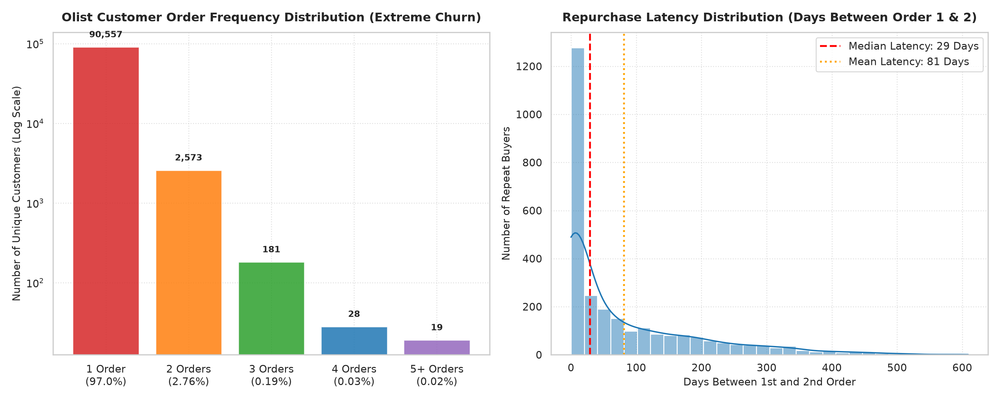

# Business Question 5: What Does Repeat-Purchase Behavior Look Like?

## 1. Business Question Formulation

**Core Question**: What does customer retention and repeat-purchasing behavior look like on the Olist e-commerce platform across unique buyers (`customer_unique_id`), what is the order frequency distribution, how long do repeat buyers wait between purchases, and how much lifetime value (LTV) do repeat customers contribute?

**Strategic Rationale**: Customer acquisition cost (CAC) in e-commerce is high. A healthy, scalable e-commerce business relies on customer retention and repeat purchase behavior to accumulate Customer Lifetime Value (LTV):
- If retention is **high**, marketing dollars generate compound returns and organic revenue stability.
- If retention is **near-zero**, the platform operates as a "leaky bucket"—relying 100% on expensive top-of-funnel acquisition to maintain transaction volume.

---

## 2. Metric & Population Definition

### 2.1 Population Criteria
- **Target Population**: All unique customer entities (`customer_unique_id`) across delivered orders in `v_customer_orders`.
- **Total Operational Baseline**: **93,358 unique customers** placing **96,478 delivered orders** generating **$15.42M in gross revenue**.

### 2.2 Core Metrics
1. **Single-Order Customer Rate (%)**:
   $$\text{Single Rate} = \left( \frac{\text{Customers with } N_{\text{orders}} = 1}{\text{Total Unique Customers}} \right) \times 100\%$$
2. **Repeat Customer Rate (%)**:
   $$\text{Repeat Rate} = \left( \frac{\text{Customers with } N_{\text{orders}} \ge 2}{\text{Total Unique Customers}} \right) \times 100\%$$
3. **Repurchase Time Latency (Days)**: Exact elapsed calendar days between a repeat customer's 1st delivered order purchase timestamp and their 2nd delivered order purchase timestamp ($\Delta t_{1 \to 2}$).
4. **Category Retention vs. Cross-Category Share (%)**: Proportion of repeat customers whose 2nd order is in the exact same product category as their 1st order vs. a different category.
5. **Customer Lifetime Value (LTV)**: Average cumulative gross dollar spend per unique customer entity ($\text{LTV} = \frac{\sum \text{Customer Gross Spend}}{N_{\text{cust}}}$).

---

## 3. Analysis Execution & Empirical Results

The analysis script [`src/business_questions/q5_repeat_purchase_behavior.py`](file:///d:/COLLEGE/DAIICT/Project/E-Commerce%20Anyalsis/src/business_questions/q5_repeat_purchase_behavior.py) was executed against `database/olist_ecommerce.db`.

### 3.1 Overall Retention & Customer Order Frequency

| Customer Cohort | Unique Customer Count | Share of Total Customers (%) | Total Orders Placed | Total Revenue Contribution ($) | Revenue Share (%) | Average LTV ($) |
| :--- | :---: | :---: | :---: | :---: | :---: | :---: |
| **Single-Order Buyers (1 Order)** | **90,557** | **97.00%** | 90,557 | **$14,555,586.29** | **94.40%** | **$160.73** |
| **Repeat Buyers (2+ Orders)** | **2,801** | **3.00%** | 5,921 | **$864,187.46** | **5.60%** | **$308.53** |
| **Total Platform Population** | **93,358** | **100.0%** | **96,478** | **$15,419,773.75** | **100.0%** | **$165.17** |

---

### 3.2 Granular Order Frequency Distribution

| Order Count ($N$) | Unique Customers | Customer Share (%) | Cumulative Customer Share (%) | Operational Sentiment |
| :---: | :---: | :---: | :---: | :--- |
| **1 Order** | **90,557** | **96.9997%** | 97.00% | 🔴 **One-and-Done Buyers (Extreme Churn)** |
| **2 Orders** | 2,573 | 2.7561% | 99.76% | 🟠 Standard Repeat Buyers |
| **3 Orders** | 181 | 0.1939% | 99.95% | 🟢 Loyal Customers |
| **4 Orders** | 28 | 0.0300% | 99.98% | 🟢 Highly Active Buyers |
| **5 Orders** | 9 | 0.0096% | 99.99% | 🟢 VIP Power Users |
| **6 Orders** | 5 | 0.0054% | 99.99% | 🟢 VIP Power Users |
| **7 Orders** | 3 | 0.0032% | 100.00% | 🟢 VIP Power Users |
| **9 Orders** | 1 | 0.0011% | 100.00% | 🟢 VIP Power User |
| **15 Orders** | 1 | 0.0011% | 100.00% | 👑 Maximum Platform Buyer (15 Orders) |

> [!WARNING]
> **Critical Finding — Structural Retention Failure**:
> Olist's repeat customer rate is **only 3.00%** (2,801 repeat buyers out of 93,358 customers). 97 out of every 100 customers make a single purchase and never buy on the platform again. Olist operates as an acquisition-dependent transactional marketplace.

---

### 3.3 Repurchase Time Latency (Order 1 $\to$ Order 2)

For the 2,801 repeat buyers, the time interval between their 1st and 2nd order displays a wide skewed distribution:

| Repurchase Latency Metric | Elapsed Days | Operational Meaning |
| :--- | :---: | :--- |
| **25th Percentile ($Q_1$)** | **0.0 Days** | Same-day multi-seller purchases (Split cart orders placed within minutes) |
| **Median Repurchase Latency ($Q_2$)** | **29.0 Days** | **Typical repeat buyer returns within ~1 month** |
| **Mean Repurchase Latency ($\mu$)** | **81.2 Days** | Average time to second purchase is ~2.7 months |
| **75th Percentile ($Q_3$)** | **126.3 Days** | Late re-engagement (~4.2 months) |

---

### 3.4 Repeat Buyer Category Behavior (Loyalty vs. Cross-Buying)

When repeat buyers place their 2nd order, do they return to the same category or explore new ones?

| Repeat Purchasing Pattern | Repeat Customer Count | Share of Repeat Orders (%) | Strategic Business Context |
| :--- | :---: | :---: | :--- |
| **Same Category Re-Purchase** | **2,222** | **52.41%** | 🔁 Category Replenishment / Brand Loyalty |
| **Cross-Category Re-Purchase** | **2,018** | **47.59%** | 🔀 Marketplace Discovery / Cross-Selling |

- **52.41%** of repeat orders stay within the exact same product category (e.g. buying refills or additional items in `health_beauty` or `bed_bath_table`).
- **47.59%** of repeat orders cross over into a completely different product category (e.g. buying `bed_bath_table` first, then returning later for `sports_leisure`).

---

## 4. Validation of Results & Financial Impact

1. **LTV Multiplier Validation**:
   - While single-order buyers generate an average spend of **$160.73**, repeat buyers generate an average lifetime spend of **$308.53**—representing a **1.92× (92% higher) LTV multiplier**.
2. **Same-Day Repurchase Latency (0.0 Days)**:
   - The 25th percentile of latency is **0.0 days** because Olist functions as a multi-seller aggregator. When a customer adds items from two different sellers to their cart, Olist processes them as separate transactions, artificially creating same-day "repeat" purchase events.

---

## 5. Visual Evidence

The dual-panel visualization below illustrates the order frequency log-scale distribution and repurchase latency histogram generated by `q5_repeat_purchase_behavior.py`:

### Chart Insights:
- **Left Panel (Log Scale Frequency)**: Shows the extreme cliff between 1-order buyers (90,557) and 2-order buyers (2,573), illustrating near-zero retention.
- **Right Panel (Latency Distribution)**: Shows that repeat buyers peak around **29 days** (dashed red line), with a long right-skewed tail extending up to 300+ days.

---

## 6. Business Insights & Strategic Recommendations

### Core Business Problem
**Olist is bleeding marketing margins on single-transaction customers. 94.4% of total revenue ($14.56M) is generated by 1-time buyers who never return.**

### Strategic Action Plan to Fix Customer Churn
1. **Automate a 30-Day Post-Purchase Trigger Campaign**:
   - Because median repurchase latency is **29.0 days**, Olist should launch an automated email/SMS re-engagement flow at Day 21 post-delivery offering a $10 coupon for their second order.
2. **Category Replenishment Reminders**:
   - Since **52.4% of repeat buyers re-purchase in the same category**, set up automated refill reminders for consumable categories (`health_beauty`, `perfumery`, `food_drink`) 30 days after initial purchase.
3. **Loyalty & Cross-Category Rewards Program**:
   - To encourage the 47.6% cross-category exploration rate, grant loyalty points on Order #1 that can only be redeemed on a *different* product category for Order #2.

---

### Code & Artifact References
- **Analysis Script**: [`src/business_questions/q5_repeat_purchase_behavior.py`](file:///d:/COLLEGE/DAIICT/Project/E-Commerce%20Anyalsis/src/business_questions/q5_repeat_purchase_behavior.py)
- **Documentation Report**: [`Business_Questions/q5_repeat_purchase_behavior.md`](file:///d:/COLLEGE/DAIICT/Project/E-Commerce%20Anyalsis/Business_Questions/q5_repeat_purchase_behavior.md)
- **Generated Visualization**: [`images/q5_repeat_purchase_behavior.png`](file:///d:/COLLEGE/DAIICT/Project/E-Commerce%20Anyalsis/images/q5_repeat_purchase_behavior.png)
