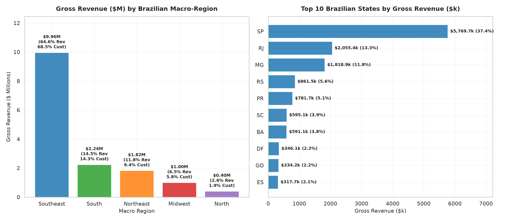

# Business Question 6: Which Regions Contribute the Most Customers and Revenue?

## 1. Business Question Formulation

**Core Question**: Which geographic macro-regions (Southeast, South, Northeast, Midwest, North), states (27 federative units), and metropolitan cities contribute the highest volume of **unique customers**, **order transactions**, and **gross revenue** on the Olist e-commerce platform, and how do freight costs and Average Order Value (AOV) vary across geographies?

**Strategic Rationale**: E-commerce logistics and fulfillment infrastructure in Brazil are strongly constrained by geography:
- **Core Demand Hubs**: Identifying high-density customer zones allows Olist to optimize seller recruitment, build regional fulfillment hubs, and negotiate bulk carrier discounts.
- **Peripheral Friction Zones**: Remote regions (e.g. North and Northeast) often face steep shipping costs ($35–$41/order) and extended delivery timelines, affecting customer conversion and AOV behavior.

---

## 2. Metric & Population Definition

### 2.1 Population Criteria
- **Target Population**: All delivered customer orders in `v_customer_orders` (93,358 unique customers, 96,478 delivered orders, $15.42M gross revenue).
- **Macro-Region Classification**:
  - **Southeast (SE)**: SP, RJ, MG, ES
  - **South (S)**: PR, RS, SC
  - **Northeast (NE)**: BA, PE, CE, MA, PB, AL, PI, RN, SE
  - **Midwest (MW)**: DF, GO, MT, MS
  - **North (N)**: AM, PA, RO, TO, AC, AP, RR

### 2.2 Core Metrics
1. **Gross Revenue ($)**: Total customer payments ($\text{Product Sales} + \text{Freight}$).
2. **Unique Customer Share (%)**: $\left(\frac{\text{Regional Customers}}{\text{Total Platform Customers}}\right) \times 100\%$.
3. **Revenue Share (%)**: $\left(\frac{\text{Regional Gross Revenue}}{\text{Total Platform Gross Revenue}}\right) \times 100\%$.
4. **Average Order Value ($\text{AOV}_{\text{region}}$)**: $\frac{\text{Regional Gross Revenue}}{\text{Regional Total Orders}}$.
5. **Average Freight Cost ($\text{Freight}_{\text{order}}$)**: $\frac{\text{Regional Total Freight}}{\text{Regional Total Orders}}$.

---

## 3. Analysis Execution & Empirical Results

The analysis script [`src/business_questions/q6_regional_customer_revenue.py`](file:///d:/COLLEGE/DAIICT/Project/E-Commerce%20Anyalsis/src/business_questions/q6_regional_customer_revenue.py) was executed against `database/olist_ecommerce.db`.

### 3.1 Brazilian Macro-Region Performance Summary

| Macro Region | Unique Customers | Customer Share (%) | Total Orders | Gross Revenue ($) | Revenue Share (%) | Regional AOV ($) | Avg Freight / Order ($) | Freight vs SE (%) |
| :--- | :---: | :---: | :---: | :---: | :---: | :---: | :---: | :---: |
| 👑 **Southeast (SE)** | **64,002** | **68.53%** | **66,200** | **$9,961,654.32** | **64.60%** | **$150.48** | **$19.84** | *Baseline* |
| 🥈 **South (S)** | **13,386** | **14.33%** | **13,814** | **$2,238,309.37** | **14.52%** | **$162.03** | **$24.35** | +22.7% |
| 🥉 **Northeast (NE)**| **8,815** | **9.44%** | **9,044** | **$1,822,543.32** | **11.82%** | **$201.52** | **$35.99** | **+81.4%** |
| 4 **Midwest (MW)** | **5,451** | **5.84%** | **5,624** | **$995,927.67** | **6.46%** | **$177.09** | **$26.49** | +33.5% |
| 5 **North (N)** | **1,742** | **1.87%** | **1,796** | **$401,339.07** | **2.60%** | **$223.46** | **$41.35** | **+108.4%** |
| **Total Platform** | **93,358** | **100.0%** | **96,478** | **$15,419,773.75** | **100.0%** | **$159.83** | **$22.77** | — |

---

### 3.2 Top 10 Brazilian States by Gross Revenue ($)

| State Rank | State Code | Macro Region | Unique Customers | Customer Share (%) | Gross Revenue ($) | Revenue Share (%) | State AOV ($) | Avg Freight ($) |
| :---: | :---: | :--- | :---: | :---: | :---: | :---: | :---: | :---: |
| **1** | **SP** | Southeast | **39,156** | **41.92%** | **$5,769,703.15** | **37.42%** | $142.46 | **$17.33** |
| **2** | **RJ** | Southeast | **11,917** | **12.76%** | **$2,055,401.57** | **13.33%** | $166.43 | $23.95 |
| **3** | **MG** | Southeast | **11,001** | **11.78%** | **$1,818,891.67** | **11.80%** | $160.20 | $23.46 |
| **4** | **RS** | South | 5,168 | 5.53% | $861,472.79 | 5.59% | $161.17 | $24.80 |
| **5** | **PR** | South | 4,769 | 5.11% | $781,708.80 | 5.07% | $158.79 | $23.49 |
| 6 | **SC** | South | 3,449 | 3.69% | $595,127.78 | 3.86% | $167.83 | $24.85 |
| 7 | **BA** | Northeast | 3,158 | 3.38% | $591,137.81 | 3.83% | $181.55 | $29.96 |
| 8 | **DF** | Midwest | 2,019 | 2.16% | $346,123.35 | 2.24% | $166.41 | $23.86 |
| 9 | **GO** | Midwest | 1,895 | 2.03% | $334,212.35 | 2.17% | $170.78 | $26.25 |
| 10 | **ES** | Southeast | 1,928 | 2.06% | $317,657.93 | 2.06% | $159.23 | $24.57 |

---

### 3.3 Top 10 Metropolitan Cities by Gross Revenue ($)

| City Rank | City Name | State | Unique Customers | Gross Revenue ($) | Platform Revenue Share (%) | City AOV ($) | Avg Freight ($) |
| :---: | :--- | :---: | :---: | :---: | :---: | :---: | :---: |
| **1** | **São Paulo** | SP | **14,528** | **$2,107,960.17** | **13.67%** | $140.11 | **$16.51** |
| **2** | **Rio de Janeiro** | RJ | **6,361** | **$1,111,732.21** | **7.21%** | $168.42 | $23.66 |
| **3** | **Belo Horizonte** | MG | 2,606 | $405,950.51 | 2.63% | $150.52 | $22.21 |
| **4** | **Brasília** | DF | 2,013 | $345,199.05 | 2.24% | $166.68 | $23.85 |
| **5** | **Curitiba** | PR | 1,434 | $238,459.72 | 1.55% | $160.15 | $21.80 |
| 6 | **Porto Alegre** | RS | 1,292 | $214,805.84 | 1.39% | $160.06 | $24.21 |
| 7 | **Campinas** | SP | 1,363 | $209,002.90 | 1.36% | $148.65 | $17.32 |
| 8 | **Salvador** | BA | 1,154 | $207,713.30 | 1.35% | $174.84 | $28.99 |
| 9 | **Guarulhos** | SP | 1,111 | $157,735.65 | 1.02% | $137.88 | $16.37 |
| 10 | **Niterói** | RJ | 788 | $135,447.96 | 0.88% | $164.18 | $23.71 |

---

### 3.4 Geographic Concentration & Compensatory AOV Behavior

> [!IMPORTANT]
> **Geographic Pareto Concentration Finding**:
> 1. **Southeast Dominance**: The Southeast region alone accounts for **68.53% of all customers** and **64.60% of total revenue ($9.96M)**.
> 2. **Top 3 States Rule**: **São Paulo (SP), Rio de Janeiro (RJ), and Minas Gerais (MG)** generate **66.46% of customers** and **62.54% of platform revenue ($9.64M)**.

```
                      REGIONAL FREIGHT vs. AOV BEHAVIOR
                                    │
           ┌────────────────────────┴────────────────────────┐
           ▼                                                 ▼
 REGION 1: Southeast (SP, RJ, MG)                REGION 2: North & Northeast (N, NE)
 --------------------------------                ----------------------------------
 • Customer Share: 68.5%                         • Customer Share: 11.3%
 • Freight per Order: $19.84 (Lowest)            • Freight per Order: $35.99 – $41.35 (+108%)
 • Average Order Value: $150.48 (Lowest)         • Average Order Value: $201.52 – $223.46 (+48%)
 • Behavior: Frequent low-basket buys            • Behavior: High-basket bulk buying to justify freight
```

- **Compensatory AOV Effect**: Customers in remote regions (North & Northeast) pay double the freight fees ($36–$41 vs $19.84 in SE). As a result, remote buyers place **48% larger order baskets ($223.46 AOV in North vs $150.48 in SE)** to amortize shipping fees over high-value goods.

---

## 5. Visual Evidence

The dual-panel visualization below illustrates macro-region gross revenue ($M) and state-level gross revenue ($k) generated by `q6_regional_customer_revenue.py`:



### Chart Insights:
- **Left Panel (Macro-Region $M)**: The Southeast region ($9.96M, 64.6% share) dwarfs all other macro-regions combined.
- **Right Panel (Top 10 States $k)**: São Paulo ($5.77M) is nearly 3× larger than Rio de Janeiro ($2.06M) and Minas Gerais ($1.82M).

---

## 6. Strategic Business Recommendations

### Strategic Action Plan
1. **Establish Dedicated Regional Fulfillment Hubs (FBA Model)**:
   - Since **64.6% of revenue is concentrated in the Southeast**, Olist should establish primary fulfillment centers in Greater São Paulo (SP) and Rio de Janeiro (RJ) to offer same-day/next-day shipping for Top 3 states.
2. **Targeted Subsidized Freight for Northeast & North Buyers**:
   - North and Northeast customers exhibit high purchase intent with **$201–$223 AOV**, but face crippling $36–$41 freight charges. Offer tiered freight discounts for high-basket orders (> $200) in NE/N to unlock massive growth potential.
3. **Metropolitan Hyper-Targeting**:
   - Focus digital marketing and seller onboarding efforts on the Top 5 cities (São Paulo, Rio, Belo Horizonte, Brasília, Curitiba), which collectively generate **27.3% of total platform sales**.

---

### Code & Artifact References
- **Analysis Script**: [`src/business_questions/q6_regional_customer_revenue.py`](file:///d:/COLLEGE/DAIICT/Project/E-Commerce%20Anyalsis/src/business_questions/q6_regional_customer_revenue.py)
- **Documentation Report**: [`Business_Questions/q6_regional_customer_revenue.md`](file:///d:/COLLEGE/DAIICT/Project/E-Commerce%20Anyalsis/Business_Questions/q6_regional_customer_revenue.md)
- **Generated Visualization**: [`images/q6_regional_customer_revenue.png`](file:///d:/COLLEGE/DAIICT/Project/E-Commerce%20Anyalsis/images/q6_regional_customer_revenue.png)
