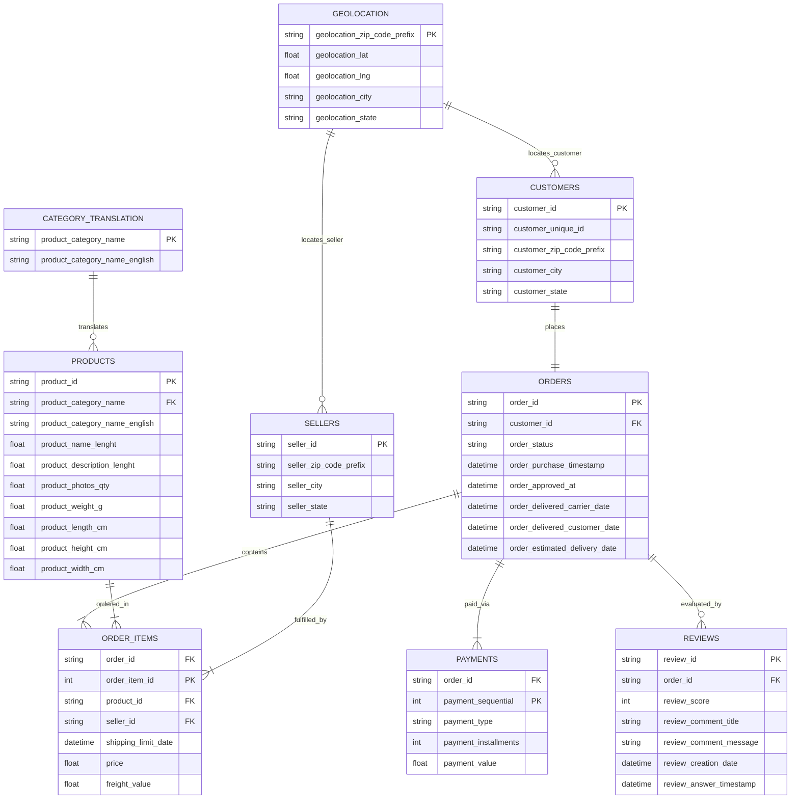

# Database Architecture & Entity-Relationship Diagram (ERD)

## Overview
This document presents the relational database architecture and Entity-Relationship Diagram (ERD) for the processed **Olist E-Commerce** datasets. The architecture centers around the `ORDERS` core transaction table, surrounded by customer, item, seller, payment, review, product, and location entities.

---

## 1. Entity-Relationship Diagram (Mermaid ERD)




---

## 2. Table Specifications & Relationships

| Table Name | Entity Grain | Primary Key (PK) | Foreign Keys (FK) | Relationship & Cardinality |
| :--- | :--- | :--- | :--- | :--- |
| **`ORDERS`** | One row per customer order | `order_id` | `customer_id` &rarr; `CUSTOMERS.customer_id` | **1:1** with `CUSTOMERS`<br>**1:N** with `ORDER_ITEMS`<br>**1:N** with `PAYMENTS`<br>**1:N** with `REVIEWS` |
| **`CUSTOMERS`** | One row per order-customer snapshot | `customer_id` | None | **1:1** with `ORDERS` |
| **`ORDER_ITEMS`** | One row per item line in an order | `(order_id, order_item_id)` | `order_id` &rarr; `ORDERS.order_id`<br>`product_id` &rarr; `PRODUCTS.product_id`<br>`seller_id` &rarr; `SELLERS.seller_id` | **N:1** with `ORDERS`<br>**N:1** with `PRODUCTS`<br>**N:1** with `SELLERS` |
| **`PAYMENTS`** | One row per payment transaction | `(order_id, payment_sequential)` | `order_id` &rarr; `ORDERS.order_id` | **N:1** with `ORDERS` |
| **`REVIEWS`** | One row per customer review response | `(review_id, order_id)` | `order_id` &rarr; `ORDERS.order_id` | **N:1** with `ORDERS` |
| **`PRODUCTS`** | One row per unique SKU | `product_id` | `product_category_name` &rarr; `CATEGORY_TRANSLATION.product_category_name` | **1:N** with `ORDER_ITEMS`<br>**N:1** with `CATEGORY_TRANSLATION` |
| **`SELLERS`** | One row per merchant/seller | `seller_id` | None | **1:N** with `ORDER_ITEMS` |
| **`CATEGORY_TRANSLATION`**| One row per category translation | `product_category_name` | None | **1:N** with `PRODUCTS` |
| **`GEOLOCATION`** | One row per zip code prefix / lat-long coordinate | `geolocation_zip_code_prefix` | None | Spatial lookup table for `CUSTOMERS` and `SELLERS` |

---

## 3. Data Architecture Layers

```
                                 +-------------------------+
                                 |  CATEGORY_TRANSLATION   |
                                 +-------------------------+
                                              |
                                              v (1:N)
+----------------+               +-------------------------+
|    SELLERS     |               |        PRODUCTS         |
+----------------+               +-------------------------+
        |                                     |
        v (1:N)                               v (1:N)
  +-------------------------------------------------+
  |                  ORDER_ITEMS                    |
  +-------------------------------------------------+
                          |
                          v (N:1)
+----------------+       +-------------------------+       +-------------------------+
|   CUSTOMERS    | ----> |         ORDERS          | <---- |        PAYMENTS         |
+----------------+ (1:1) +-------------------------+ (1:N) +-------------------------+
                          | (1:N)
                          v
                 +-------------------------+
                 |         REVIEWS         |
                 +-------------------------+
```

---

## 4. Key Architectural Highlights
1. **Central Transaction Table (`ORDERS`)**: Serves as the primary fact anchor for order lifecycles, timestamps, and customer relationships.
2. **Normalized Item Granularity (`ORDER_ITEMS`)**: Bridges `ORDERS`, `PRODUCTS`, and `SELLERS` at the individual item line level.
3. **Multi-Payment & Multi-Review Support**: `PAYMENTS` and `REVIEWS` accommodate 1-to-many relationship cardinality per order without data fan-out in the primary order table.
4. **Clean Lookup Dimensions**: `PRODUCTS` maps to `CATEGORY_TRANSLATION` for English translations, while `CUSTOMERS` and `SELLERS` link to `GEOLOCATION` for spatial analytics.
