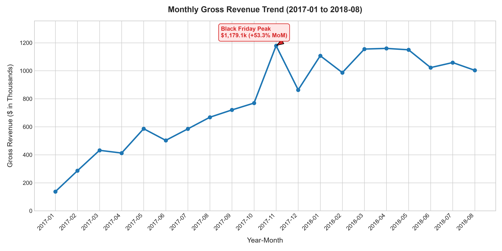
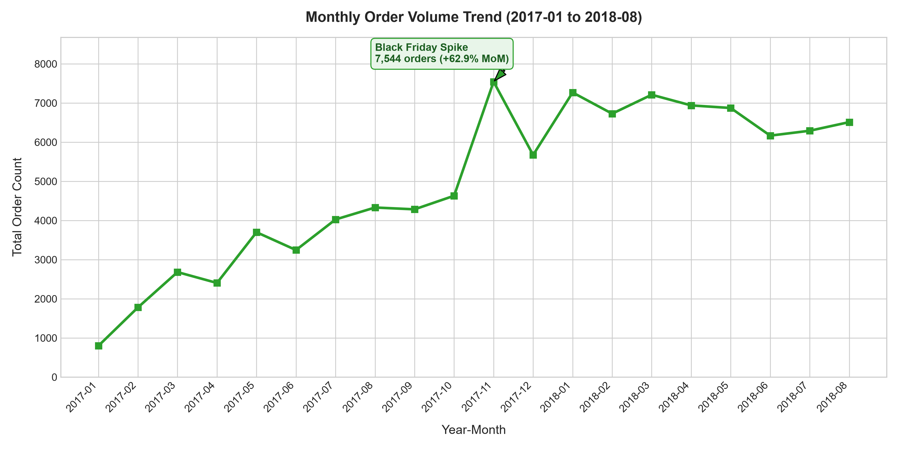
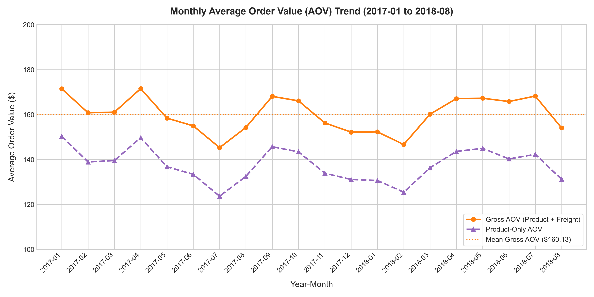
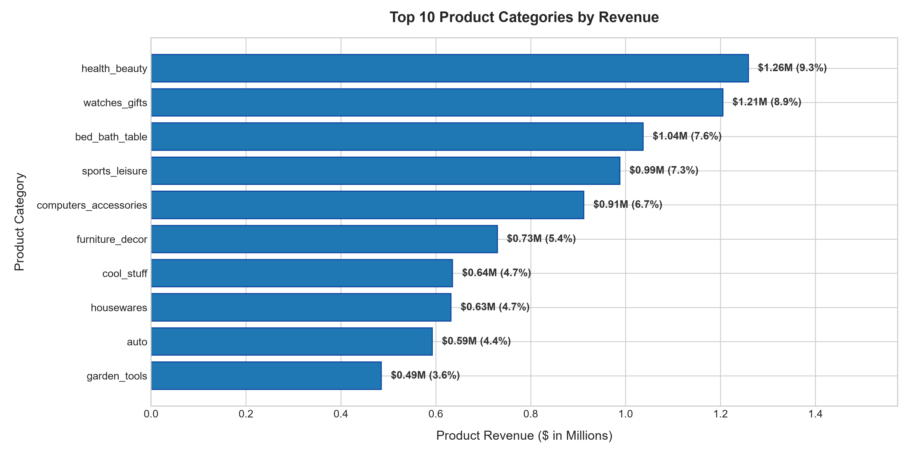

# Phase 5.1 — Revenue & Sales Performance KPI Report

## 1. Executive Summary & Explicit KPI Definitions

### Validated KPI Mathematical Formulations
- **Product Revenue** $= \sum(\text{price})$ across order items.
- **Freight Charges** $= \sum(\text{freight\_value})$ across order items.
- **Gross Revenue** $= \text{Product Revenue} + \text{Freight Charges}$.
- **Gross AOV** $= \frac{\text{Gross Revenue}}{\text{Total Orders}}$.

> **Note on Payment Reconciliation**: We calculate revenue from order items (`price` + `freight_value`) rather than payments because customers can pay with multiple payment methods (e.g. credit card + voucher) or split installments, which can cause payment-level fan-out.

### Executive KPI Metrics
- **Total Order Volume**: 99,441
- **Delivered Orders**: 96,478 (97.02% completion rate)
- **Total Product Revenue**: $13,591,643.70
- **Total Freight Charges**: $2,251,909.54 (14.21% of Gross)
- **Total Gross Revenue**: $15,843,553.24
- **Overall Gross AOV**: $159.33
- **Product-Only AOV**: $136.68

## 2. Monthly Trend Investigation & Edge-Month Handling

The raw purchase timestamps span from **2016-09-04** to **2018-10-17**.

- **Partial Edge Months**: `2016-09` (4 orders), `2016-10` (324 orders), `2016-12` (1 order), `2018-09` (16 orders), and `2018-10` (4 orders) represent system launch testing or data ingestion truncation cutoffs. These are flagged with `is_full_month = False` and excluded from MoM growth calculation and forecasting training.
- **Clean Operational Window**: **`2017-01` to `2018-08`** (20 continuous full operational months).

### Clean Operational Monthly Trend Table (2017-01 to 2018-08)

| year_month | total_orders | delivered_orders | product_revenue | freight_charges | gross_revenue | aov_gross | mom_revenue_growth_pct | mom_order_growth_pct |
| --- | --- | --- | --- | --- | --- | --- | --- | --- |
| 2017-01 | 800 | 750 | 120,312.87 | 16,875.62 | 137,188.49 | 171.49 | — | — |
| 2017-02 | 1,780 | 1,653 | 247,303.02 | 38,977.60 | 286,280.62 | 160.83 | 108.68 | 122.50 |
| 2017-03 | 2,682 | 2,546 | 374,344.30 | 57,704.29 | 432,048.59 | 161.09 | 50.92 | 50.67 |
| 2017-04 | 2,404 | 2,303 | 359,927.23 | 52,495.01 | 412,422.24 | 171.56 | -4.54 | -10.37 |
| 2017-05 | 3,700 | 3,546 | 506,071.14 | 80,119.81 | 586,190.95 | 158.43 | 42.13 | 53.91 |
| 2017-06 | 3,245 | 3,135 | 433,038.60 | 69,924.44 | 502,963.04 | 155.00 | -14.20 | -12.30 |
| 2017-07 | 4,026 | 3,872 | 498,031.48 | 86,940.14 | 584,971.62 | 145.30 | 16.31 | 24.07 |
| 2017-08 | 4,331 | 4,193 | 573,971.68 | 94,232.92 | 668,204.60 | 154.28 | 14.23 | 7.58 |
| 2017-09 | 4,285 | 4,150 | 624,401.69 | 95,997.22 | 720,398.91 | 168.12 | 7.81 | -1.06 |
| 2017-10 | 4,631 | 4,478 | 664,219.43 | 105,092.94 | 769,312.37 | 166.12 | 6.79 | 8.07 |
| 2017-11 | 7,544 | 7,289 | 1,010,271.37 | 168,872.40 | 1,179,143.77 | 156.30 | 53.27 | 62.90 |
| 2017-12 | 5,673 | 5,513 | 743,914.17 | 119,633.06 | 863,547.23 | 152.22 | -26.76 | -24.80 |
| 2018-01 | 7,269 | 7,069 | 950,030.36 | 157,271.53 | 1,107,301.89 | 152.33 | 28.23 | 28.13 |
| 2018-02 | 6,728 | 6,555 | 844,178.71 | 142,730.25 | 986,908.96 | 146.69 | -10.87 | -7.44 |
| 2018-03 | 7,211 | 7,003 | 983,213.44 | 171,913.38 | 1,155,126.82 | 160.19 | 17.04 | 7.18 |
| 2018-04 | 6,939 | 6,798 | 996,647.75 | 163,050.29 | 1,159,698.04 | 167.13 | 0.40 | -3.77 |
| 2018-05 | 6,873 | 6,749 | 996,517.68 | 153,264.14 | 1,149,781.82 | 167.29 | -0.86 | -0.95 |
| 2018-06 | 6,167 | 6,099 | 865,124.31 | 157,552.80 | 1,022,677.11 | 165.83 | -11.05 | -10.27 |
| 2018-07 | 6,292 | 6,159 | 895,507.22 | 163,220.81 | 1,058,728.03 | 168.27 | 3.53 | 2.03 |
| 2018-08 | 6,512 | 6,351 | 854,686.33 | 148,622.14 | 1,003,308.47 | 154.07 | -5.23 | 3.50 |

## 3. Revenue & Sales Visualizations

## 4. Category Revenue Concentration Analysis

The top 10 categories generate **62.39%** ($8.48M) of all product sales revenue across 74 categories:

| product_category_name_english | items_sold | product_revenue | revenue_share_pct | cumulative_revenue_share_pct | avg_item_price |
| --- | --- | --- | --- | --- | --- |
| health_beauty | 9,670 | 1,258,681.34 | 9.26 | 9.26 | 130.16 |
| watches_gifts | 5,991 | 1,205,005.68 | 8.87 | 18.13 | 201.14 |
| bed_bath_table | 11,115 | 1,036,988.68 | 7.63 | 25.76 | 93.30 |
| sports_leisure | 8,641 | 988,048.97 | 7.27 | 33.03 | 114.34 |
| computers_accessories | 7,827 | 911,954.32 | 6.71 | 39.74 | 116.51 |
| furniture_decor | 8,334 | 729,762.49 | 5.37 | 45.10 | 87.56 |
| cool_stuff | 3,796 | 635,290.85 | 4.67 | 49.78 | 167.36 |
| housewares | 6,964 | 632,248.66 | 4.65 | 54.43 | 90.79 |
| auto | 4,235 | 592,720.11 | 4.36 | 58.79 | 139.96 |
| garden_tools | 4,347 | 485,256.46 | 3.57 | 62.36 | 111.63 |
