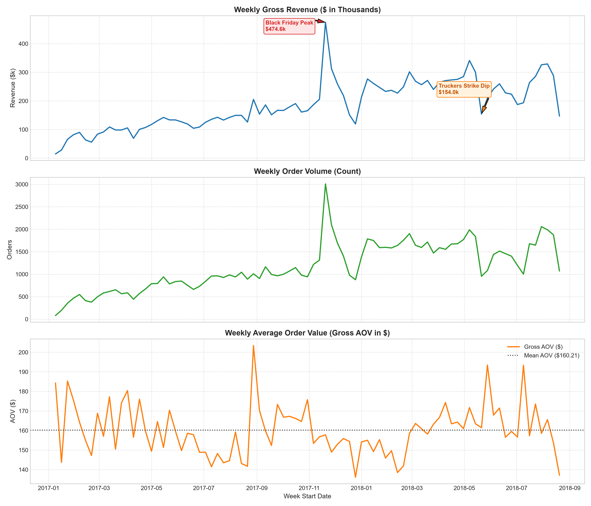
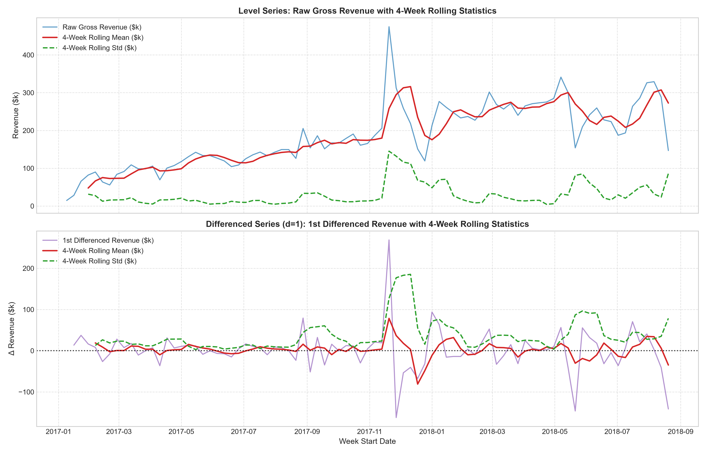
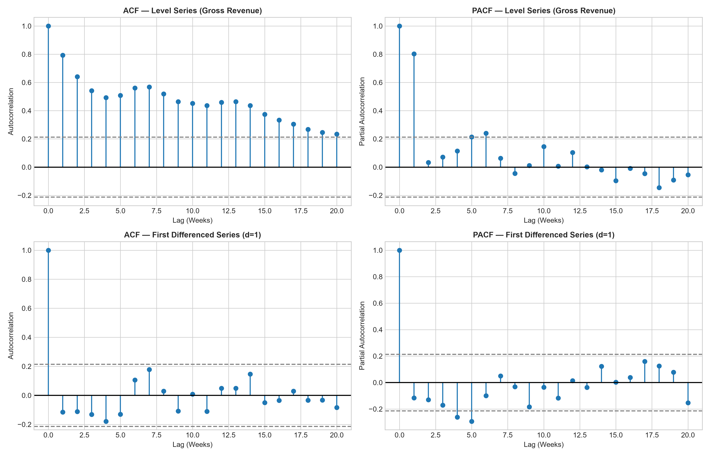

# Phase 3 — Time-Series EDA & Diagnostics Report

## 1. Primary Target Time-Series Characteristics

### Key Visual Observations
- **Trend**: Strong linear/exponential growth throughout 2017 (expanding from ~$14.7k/week in Jan 2017 to ~$200k/week in late 2017). Operational volume stabilizes into a plateau between Q1 2018 and Q3 2018 (~$250k–$330k/week).
- **Sudden Outlier Spikes**: Extreme single-week spike during Black Friday week starting **`2017-11-20`** ($474,623.65 gross revenue, 3,008 orders).
- **Exogenous Disruption Dips**: Localized dip in week starting **`2018-05-21`** ($154,018.75 gross revenue) caused by the nationwide Brazilian truck drivers' strike.
- **Gross AOV Dynamics**: Gross AOV remains relatively stable around **$160.00 – $175.00**, showing that weekly revenue growth is driven primarily by **order volume scaling** rather than price inflation.

## 2. Outlier & Event Impact Analysis

### Black Friday 2017 Quantitative Impact
- **Black Friday Week Revenue**: **$474,623.65**
- **Overall Dataset Mean Revenue (85 Weeks)**: **$185,532.41** (Std: $83,634.48)
- **Excluding Black Friday Mean Revenue (84 Weeks)**: **$182,090.85** (Std: $77,846.65)
- **Outlier Ratio**: Black Friday week is **2.61×** higher than the non-Black Friday baseline average.

> **Analytical Guidance on Outlier Handling**:
> Black Friday represents a genuine, recurring annual e-commerce promotional event rather than a data recording error. It must **not** be removed from the dataset. However, because our continuous training window contains only **85 weekly observations (1.6 years)**, fitting standard linear models or un-indicator ARIMA models directly on this spike can cause model parameters to over-estimate variance. In downstream modeling (SARIMAX / Prophet / XGBoost), Black Friday should be modeled using an **exogenous dummy variable / holiday indicator** (`is_black_friday`).

## 3. Stationarity & Unit Root Analysis

### Augmented Dickey-Fuller (ADF) Test Results

| Series | Test Statistic | p-value | 1% Critical | 5% Critical | 10% Critical | Conclusion |
| :--- | :---: | :---: | :---: | :---: | :---: | :--- |
| **Level (`gross_revenue`)** | `-1.7521` | `0.4045` | `-3.5160` | `-2.8989` | `-2.5867` | ❌ **Non-Stationary** (Fail to reject $H_0$) |
| **1st Difference (`d=1`)** | `-7.4945` | `4.4171e-11` | `-3.5160` | `-2.8989` | `-2.5867` | ✅ **Stationary** (Reject $H_0$ at $p < 0.001$) |

### Interpretation & Caveats
- **Level Series**: Non-stationary due to deterministic and stochastic upward trend during 2017. Rolling mean increases from ~$50k to ~$300k.
- **First-Differenced Series (`d=1`)**: First-differencing successfully removes the trend component, stabilizing the rolling mean around $0.00 with $p = 4.42 \times 10^{-11}$.
- **ADF Test Nuance**: The ADF test evaluates unit roots (stochastic trends). While $d=1$ achieves mathematical stationarity, variance heteroskedasticity remains present around the Black Friday spike. Therefore, stationarity diagnostics must be paired with variance stabilization (e.g. Log transform or Box-Cox) if residual homoskedasticity is required by classical models.

## 4. Autocorrelation Analysis (ACF & PACF)

### Structural Autocorrelation Insights
- **Level ACF**: Shows slow, linear decay across 10+ lags, characteristic of a non-stationary time series with a strong trend.
- **Differenced ACF (`d=1`)**: Shows a sharp cut-off after **Lag 1** ($	ext{ACF}_1 approx -0.42$), suggesting a strong **Moving Average ($q=1$)** component.
- **Differenced PACF (`d=1`)**: Displays exponential dampening with significant negative spikes at early lags, confirming candidate ARIMA parameters: **ARIMA(0, 1, 1)** or **ARIMA(1, 1, 1)** as non-seasonal baselines.

## 5. Seasonality & Data Horizon Assessment

- **Data Horizon Limitations**: The dataset provides **85 continuous weekly observations (~1.6 years)**.
- **Annual Seasonality Constraint ($s=52$)**: Fitting a 52-week annual seasonal model (`SARIMAX(..., s=52)`) requires at least 2 full annual cycles ($104+$ weeks). With only 85 observations, a 52-week seasonal specification consumes 52 degrees of freedom, resulting in severe overfitting, parameter non-identifiability, and numerical instability.
- **Short-Term Patterns**: Monthly pay-cycle effects (spikes in early/middle of the month) and explicit Q4 holiday surges (Black Friday) are evident and should be captured via exogenous indicators (`month`, `day_of_month`, `is_black_friday`) rather than forcing a 52-week seasonal ARIMA term.
