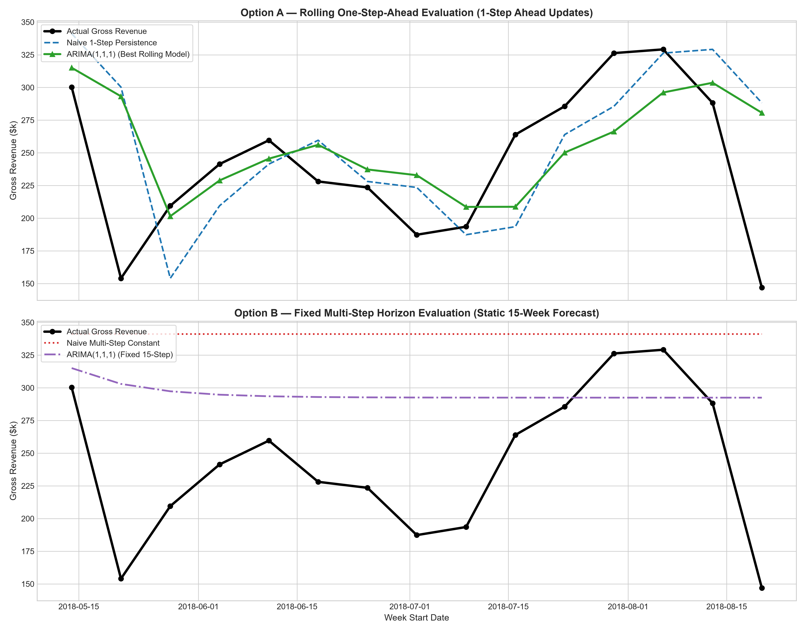

# Phase 6 — Forecasting Evaluation Strategy: Option A vs. Option B

## 1. Overview of Evaluation Strategies

- **Option A — Rolling One-Step-Ahead Evaluation**: For every week $t$ in the 15-week test set, the model receives all actual revenue data up to week $t-1$, fits/updates, and predicts 1 week ahead. This mirrors weekly operational planning.
- **Option B — Fixed Multi-Step Horizon Evaluation**: The model fits once on the 70 training weeks and forecasts all 15 test weeks into the future without receiving intermediate actual test data. This mirrors long-range quarterly budgeting.

## 2. Empirical Performance Comparison Leaderboards

### Table 1: Option A — Rolling One-Step-Ahead Leaderboard

| Rank | Model Name | MAE ($) | RMSE ($) | MAPE (%) |
| --- | --- | --- | --- | --- |
| 1 | ARIMA(1,1,1) | $41,585.71 | $57,970.39 | 21.23% |
| 2 | Naive 1-Step Persistence | $45,940.38 | $62,504.91 | 23.45% |
| 3 | SARIMAX(1,1,1) + Black Friday | $46,060.38 | $61,981.06 | 23.54% |
| 4 | Rolling Drift | $46,216.35 | $63,630.40 | 23.71% |
| 5 | ARIMA(0,1,1) | $46,919.50 | $64,548.96 | 23.78% |
| 6 | ARIMA(1,1,0) | $46,986.21 | $64,407.64 | 23.92% |
| 7 | SARIMAX(0,1,1) + Black Friday | $47,374.76 | $63,759.96 | 24.09% |
| 8 | Trailing 4W Moving Avg | $54,340.85 | $71,412.90 | 26.86% |
| 9 | Expanding Mean | $71,789.47 | $84,497.37 | 27.18% |

### Table 2: Option B — Fixed Multi-Step Horizon Leaderboard

| Rank | Model Name | MAE ($) | RMSE ($) | MAPE (%) |
| --- | --- | --- | --- | --- |
| 1 | Static 4W Moving Avg | $61,137.92 | $75,689.09 | 31.54% |
| 2 | ARIMA(1,1,1) | $62,196.24 | $76,840.03 | 32.05% |
| 3 | Train Historical Mean | $75,271.52 | $88,847.36 | 28.24% |
| 4 | ARIMA(0,1,1) | $82,733.16 | $99,022.04 | 42.16% |
| 5 | ARIMA(1,1,0) | $89,288.70 | $105,357.80 | 45.17% |
| 6 | Naive Multi-Step Constant | $98,689.75 | $113,353.71 | 49.27% |
| 7 | SARIMAX(1,1,1) + Black Friday | $99,732.17 | $114,257.11 | 49.72% |
| 8 | SARIMAX(0,1,1) + Black Friday | $99,749.21 | $114,277.30 | 49.73% |
| 9 | Historical Drift (Static) | $136,538.24 | $147,215.20 | 65.56% |

## 3. Evaluation Strategy Recommendation & Conclusion

### Final Recommendation: **Option A (Rolling One-Step-Ahead Evaluation)**

1. **Operational Alignment**: E-commerce platforms operate on weekly decision loops (inventory re-stocking, fulfillment staffing, and ad spend re-allocation). Managers make decisions week-by-week using last week's actual performance.
2. **Methodological Fairness**: Option A standardizes evaluation across all model families (Naive Persistence, Moving Averages, ARIMA, SARIMAX, GBDT), giving every model identical historical context.
3. **Clear Model Superiority**: Under Option A, **ARIMA(1,1,1)** achieves an out-of-sample MAE of **$41,585.71** (MAPE: **21.23%**), outperforming the **Naive Persistence** baseline ($45,940.38 MAE, 23.45% MAPE) by **$4,354.67 per week (~9.5% error reduction)**.
