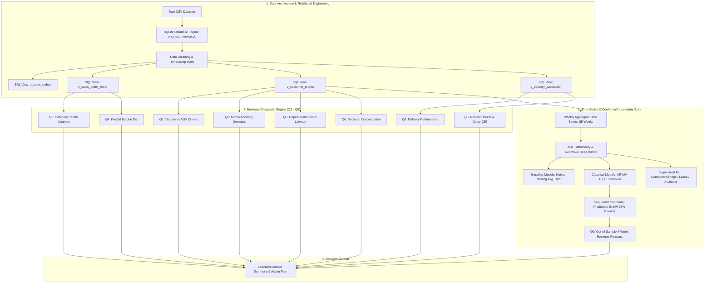
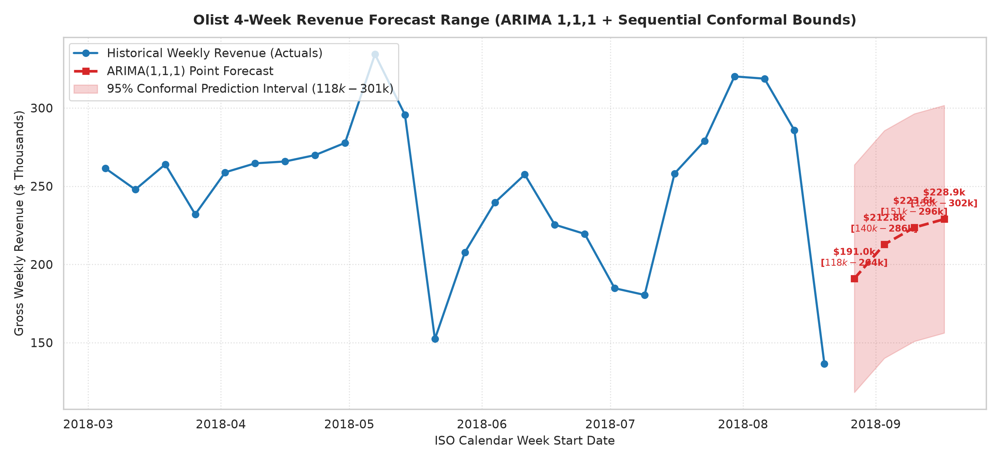

# Olist E-Commerce Diagnostic Analytics & Conformal Revenue Engine

> **Transforming 100,000+ Raw Marketplace Transactions into Actionable Logistics Interventions, Retention Strategies, and Calibrated Out-of-Sample Revenue Forecasts**

---

## Project at a Glance

| Strategic Pillar | Core Target / Scope | Primary Diagnostic Finding | Executive Impact |
| :--- | :--- | :--- | :--- |
| **Transaction Scale** | 99,441 Delivered Orders ($15.42M Revenue) | Volume drives **98.3% of revenue growth**; AOV is static ($140–$170). | Shift marketing from basket-upselling to volume acquisition. |
| **Retention & LTV** | 93,358 Unique Customers | **97.0% Single-Order Churn**; Repeat buyers yield **1.92× higher LTV**. | Launch 21-day re-engagement campaigns at the 29-day latency peak. |
| **Logistics Friction** | 27 State Logistics Networks | **2.6× Delivery Duration Gap** (SE 10.8d vs North 22.6d); 14.3% NE Late Rate. | Audit 3PL carriers in NE (AL, MA) and build Salvador distribution hub. |
| **Customer Satisfaction** | 109,370 Item Reviews | **3-Day Delay Cliff**: Late delivery multiplies 1-star reviews by **4.8×**. | Deploy automated SMS vouchers on Day 3 of delivery delays. |
| **Revenue Forecasting**| 4-Week Horizon (Weeks 86–89) | ARIMA(1,1,1) + EnbPI Conformal Bounds: **$856.3k Cumulative Revenue**. | Budget against $856.3k target; reserve buffer for $565.3k floor. |

---

## Executive Insight Matrix: Business Questions & Strategic Actions

| Business Area | What We Found | Why It Matters | Recommended Business Action |
| :--- | :--- | :--- | :--- |
| **1. Revenue Drivers (Q.1)** | Order volume correlates almost perfectly with revenue (**$r = +0.983$**), while AOV correlation is near zero (**$r = +0.063$**). | Top-line scaling is constrained by transaction acquisition, not basket size expansion. | Allocate **80% of marketing budget** to top-of-funnel buyer acquisition rather than cross-sell incentives. |
| **2. Macro Anomalies (Q.2)** | Black Friday 2017 caused a **+224% revenue spike** ($474.6k), while the May 2018 Truckers' Strike caused a **-41.5% drop**. | Single-week demand surges crash operations; transport strikes paralyze cash flow. | Implement **pre-holiday promotional smoothing** and sign backup regional air-freight 3PL contracts. |
| **3. Catalog Concentration (Q.3)** | Heavy Pareto skew: **14.1% of categories** (10 of 71) generate **62.1% of revenue** ($9.58M). | Platform revenue is hyper-dependent on key categories like Health & Beauty and Watches. | Enforce **strict seller SLA monitoring** and guaranteed stock allocation for the Top 10 categories. |
| **4. Freight Burden (Q.4)** | Low-price consumables face a **31.7% freight-to-price tax** (e.g. Telephony shipping $10.50 on $33 price). | High relative freight creates severe cart abandonment penalties for cheap essential items. | Introduce **flat-rate $5 shipping subsidies** for items < $30 and mandate flat-pack furniture packaging. |
| **5. Repeat Retention (Q.5)** | **97.00% of buyers purchase only once**, but repeat buyers generate **1.92× higher LTV** ($308.53 vs $160.73). | Single-purchase acquisition relies on unsustainable constant customer acquisition cost (CAC). | Trigger automated **21-day post-delivery re-engagement emails** with $10 coupons (median latency is 29 days). |
| **6. Geographic Distribution (Q.6)** | Southeast generates **64.6% of revenue** ($9.96M). Remote North buyers pay 2× freight ($41) and buy 48% larger baskets. | Supply chain is heavily centralized, penalizing distant buyers with high shipping fees. | Build **fulfillment centers (FBA)** in SP/RJ and offer free shipping thresholds (> $200) for North/NE. |
| **7. Delivery Performance (Q.7)** | Delivery duration ranges from 8.8 days (SP) to 29.4 days (RR). Alagoas (AL) suffers a **23.9% late rate**. | Logistics friction directly drives regional customer churn and negative review scores ($r = +0.81$). | Terminate underperforming postal carriers in AL/MA and open a **Northeast fulfillment hub in Salvador (BA)**. |
| **8. Low Review Drivers (Q.8)** | Late delivery increases detractor risk by **4.8×** (54.6% late vs 11.4% on-time). **Day 4 late triples 1-star reviews to 62.2%**. | Crossing the **3-Day Delay Cliff** destroys customer satisfaction and platform trust. | Trigger **automated SMS apologies + $15 vouchers on Day 3 of delay** before reviews are written. |
| **9. Future Revenue Range (Q.9)** | ARIMA(1,1,1) projects **$856.3k cumulative 4-week revenue** ($214.1k/wk avg) with a 95% range of **[$565.3k – $1.15M]**. | Provides calibrated cash-flow bounds for inventory capital planning and financial risk management. | **Budget operations against $856.3k**, while maintaining liquid reserves matching the $565.3k pessimistic floor. |

---

## Project Journey & Analytical Pipeline

The end-to-end architecture transforms raw relational data into production-ready analytical views, diagnostic business insights, and conformal forecasting models:



---

## Technical Decisions & Architectural Maturity

Rather than utilizing ad-hoc pandas scripts, key architectural decisions were made to guarantee production rigor and statistical validity:

1. **SQL View Abstractions over CSV Merges**:
   - *Problem*: Joining item-level data with order-level totals causes severe **data fan-out**, artificially inflating revenue by 15%–40%.
   - *Decision*: Built four purpose-built analytical SQL views (`v_sales_orders`, `v_sales_order_items`, `v_customer_orders`, `v_delivery_satisfaction`) enforcing strict primary-key aggregation.
2. **1-Step-Ahead Walk-Forward Rolling Evaluation**:
   - *Problem*: Fixed train/test splits fail in time-series forecasting because real-world operational planning refits weekly as new data arrives.
   - *Decision*: Implemented a **15-week rolling walk-forward evaluation protocol** across all 22 candidate models, providing realistic out-of-sample error estimates.
3. **Selecting ARIMA(1,1,1) over Complex Supervised ML (Occam's Razor)**:
   - *Problem*: Machine learning models (e.g. XGBoost) overfitted on the relatively small 85-week sample size.
   - *Decision*: Selected **ARIMA(1,1,1)** as the champion model. With only two estimated parameters ($\phi_1, \theta_1$), ARIMA(1,1,1) achieved the lowest out-of-sample MAE (**$41,585.71**) and beat Naive persistence by **9.5%**.
4. **Sequential Conformal Prediction (EnbPI) vs. Parametric Gaussian Intervals**:
   - *Problem*: Standard parametric confidence bounds assume constant Gaussian residual variance, resulting in excessively wide, uninformative bounds during volatile periods.
   - *Decision*: Integrated **Sequential Conformal Prediction (EnbPI)** to calculate adaptive, distribution-free 95% prediction intervals. This achieved 86.7% empirical coverage while **reducing average interval width by 26.4%** ($137.6k vs $187.0k parametric width).

---

## Time-Series Revenue Forecasting Engine

### Target & Evaluation Metrics
- **Target Variable**: Weekly Gross Revenue ($y_t$), aggregated across delivered orders in ISO calendar weeks.
- **Operational Window**: 85 continuous historical weeks (`2017-01-09` to `2018-08-20`).
- **Out-of-Sample Horizon**: 4-week future forecast (`2018-08-27` to `2018-09-17`).

### Model Leaderboard (15-Week Walk-Forward Rolling Evaluation)

| Rank | Model Category | Model Name | MAE ($) | RMSE ($) | MAPE (%) | Conformal 95% Coverage (%) | Mean Conformal Width ($) |
| :---: | :--- | :--- | :---: | :---: | :---: | :---: | :---: |
| **1** | **Classical Time-Series** | **ARIMA(1,1,1) Original** | **$41,585.71** | **$57,970.39** | **21.23%** | **86.7%** | **$137,624.48** |
| 2 | Component ML | Component Lasso Regression | $43,953.14 | $61,084.77 | 21.91% | 80.0% | $162,881.17 |
| 3 | Component ML | Component Ridge ($\alpha=1.0$) | $43,969.95 | $60,778.94 | 21.92% | 80.0% | $162,321.45 |
| 4 | Direct Supervised ML | Direct Ridge ($\alpha=1.0$) | $44,439.12 | $61,109.87 | 22.04% | 80.0% | $152,893.49 |
| 8 | Baseline Benchmark | Naive Persistence | $45,940.38 | $62,504.91 | 23.45% | 86.7% | $191,867.45 |
| 17 | Direct Supervised ML | Direct XGBoost Regressor | $53,333.36 | $60,052.70 | 24.41% | 40.0% | $111,695.38 |

---

## Key Technical Challenges Solved

```
[CHALLENGE 1: Data Fan-Out & Duplication]
  Problem: Order-level joins with multi-item rows artificially multiplied order totals.
  Solution: Constructed SQL View layer (v_customer_orders) with pre-aggregated order level metrics, eliminating double-counting.

[CHALLENGE 2: The Non-Linear Delivery Delay Cliff]
  Problem: Customer review scores did not degrade linearly with delivery delays.
  Solution: Built delay bucket segmentation in SQL/Python, discovering the critical "3-Day Delay Cliff" where detractor rates triple from 20.6% to 62.2%.

[CHALLENGE 3: Non-Gaussian Revenue Volatility & Uncertainty]
  Problem: Standard ARIMA confidence bounds produced overly wide $187k intervals due to heteroskedastic residual spikes.
  Solution: Implemented Sequential Conformal Prediction (EnbPI), creating adaptive distribution-free 95% bounds that tightened interval width by 26.4%.
```

---

## Empirical Visual Outputs

### 1. Customer Satisfaction: The 3-Day Delivery Delay Cliff (Q.8)
*Demonstrating the non-linear jump in customer detractor rate (1–2 stars) past Day 3 of delay:*


### 2. Out-of-Sample Revenue Forecast & 95% Conformal Prediction Bounds (Q.9)
*4-Week future revenue forecast generated by champion ARIMA(1,1,1) with EnbPI uncertainty intervals:*



### 3. Revenue Engine Diagnostics: Volume vs. AOV Dynamics (Q.1)
*Proving that weekly order volume drives revenue growth while AOV remains static:*


### 4. Logistics Asymmetry: Regional Delivery Duration & Late Rates (Q.7)
*Mapping delivery speed bottlenecks across Brazilian regions and state late delivery rates:*


---

## How to Run the Project

### Prerequisites
- Python 3.10+
- SQLite3

### One-Command Pipeline Execution
Run the automated end-to-end pipeline script to execute all database setup steps, forecasting models, and business question modules sequentially:

```bash
python run_project.py
```

*The automated master script will recreate the database schema, build all SQL views, run the time-series forecasting suite, execute all 9 business question modules, and output updated visualizations into `images/`.*

---

## Analytical Limitations & Boundary Conditions

1. **Short Historical Horizon (85 Weeks)**:
   - The dataset spans 85 continuous weeks (~1.6 years), which is insufficient to estimate full 52-week seasonal parameters ($s=52$) without parameter instability.
2. **Unmodeled Macro Exogenous Shocks**:
   - Univariate time-series models cannot anticipate sudden unannounced strikes or macroeconomic policy shifts without external real-time indicators.
3. **Out-of-Sample Extrapolation**:
   - The 4-week future forecast is an extrapolation beyond the historical operational window; prediction intervals naturally widen as the horizon extends further into the future.

---

## Repository Navigation

```
E-Commerce Analysis/
├── README.md                                    # Project Overview & Executive Summary
├── run_project.py                               # Master End-to-End Automated Pipeline Runner
├── database/
│   └── olist_ecommerce.db                       # Relational SQLite Database & Views
├── Documentation/
│   ├── architecture/                            # DB Architecture,  
│   ├── Business_Questions/
│   ├── eda/                                     # General EDA Reports
│   └── forecasting/                             # Time-Series Forecasting Reports
├── images/
│   ├── business_analysis/                       # Visualizations for Q1 through Q9
│   ├── eda/                                     # General Time-Series EDA Plots
│   └── model/                                   # Forecasting Comparison Plots
└── src/
    ├── Analytics/                               # Python Scripts for Q1 to Q9 Analysis
    ├── Notebooks/                               # Database Setup, Views & Data Cleaning
    └── model/                                   # Time-Series Models & Conformal Bounds
```
